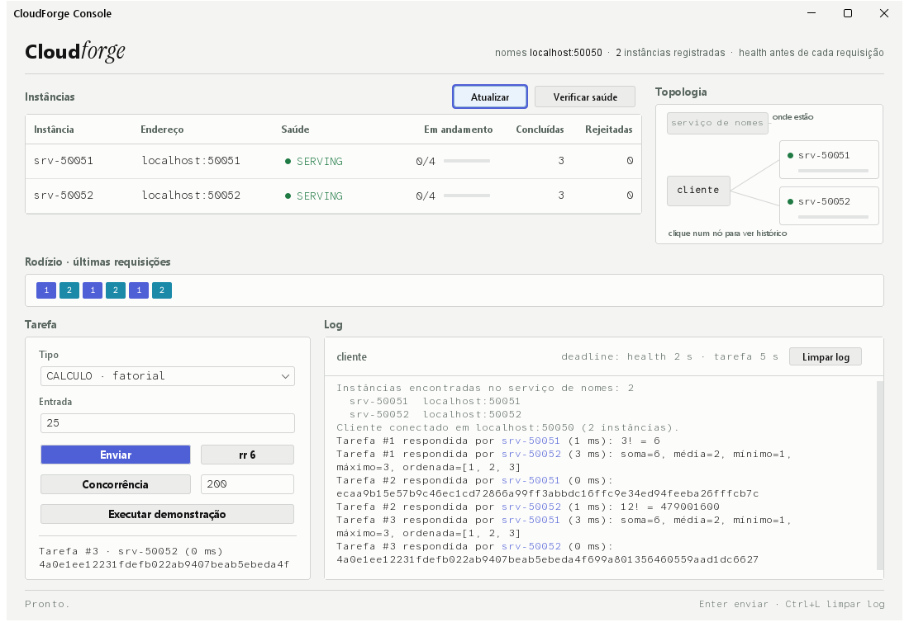
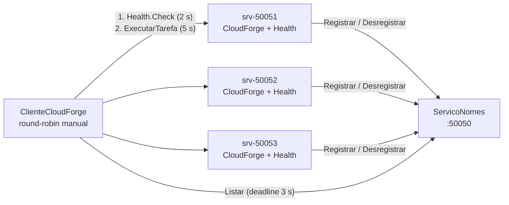
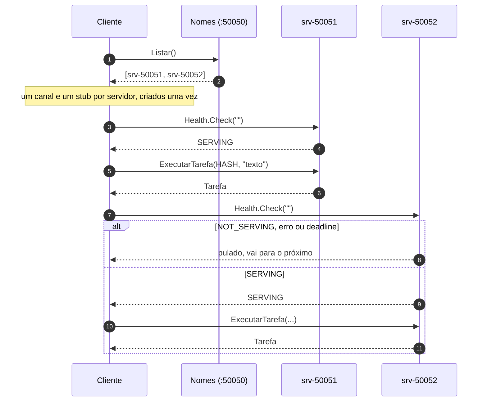
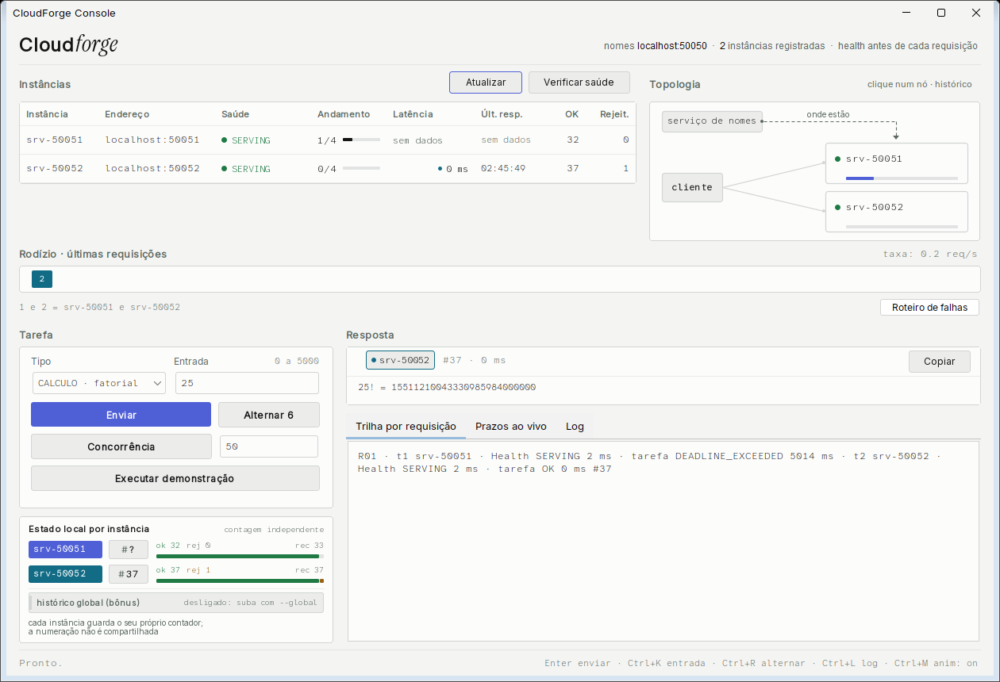
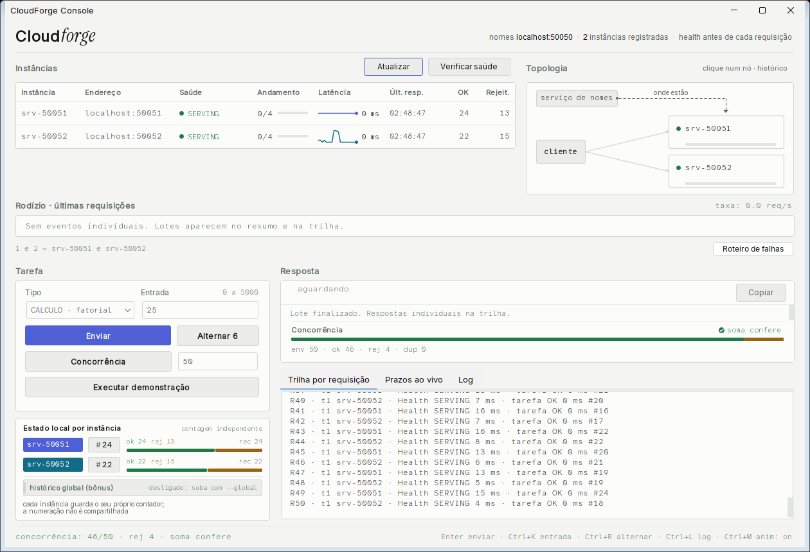
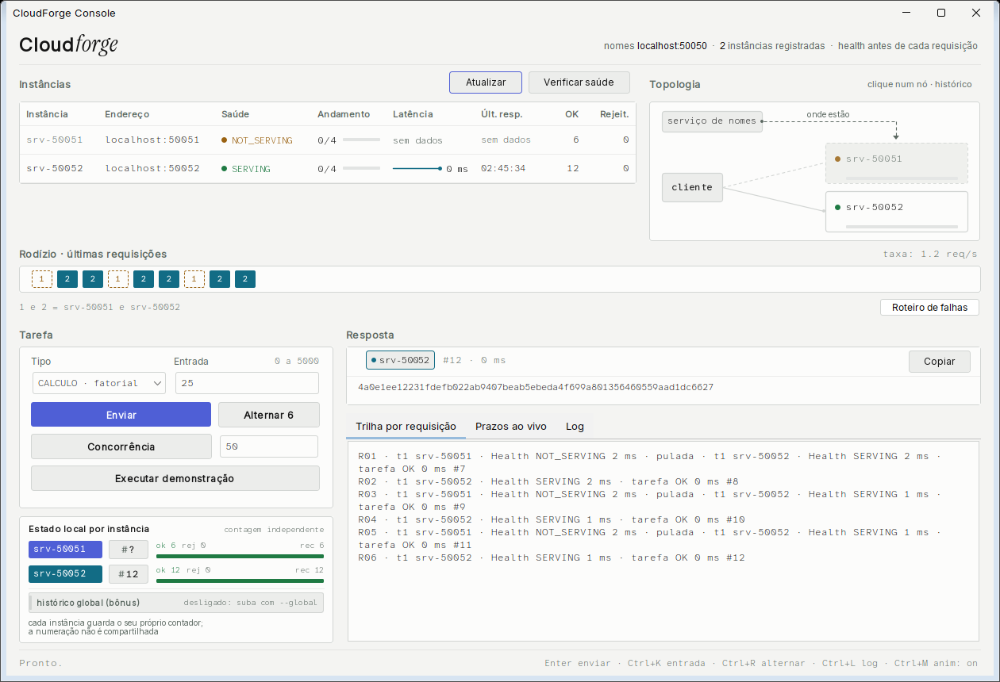
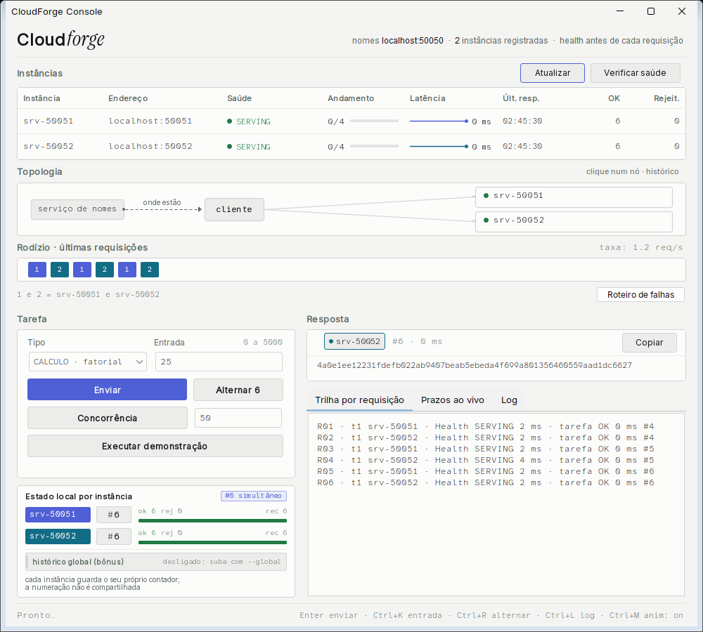

<div align="center">

# CloudForge · gRPC

Processamento distribuído em nuvem: várias instâncias de um servidor, um serviço de nomes e um cliente que escolhe a instância.<br>O cliente descobre os servidores, confere a saúde de cada um antes de cada chamada e faz o rodízio na mão.


[Rodar](#passo-a-passo-rodar-testar-e-encerrar) ·
[Arquitetura](#arquitetura) ·
[Decisões](#decisões-de-projeto) ·
[Contrato](#contrato-grpc) ·
[Comandos](#comandos) ·
[Testes](#roteiro-de-testes) ·
[Bônus](#bônus-histórico-global) ·
[Enunciado](#conformidade-com-o-enunciado) ·
[Prompts](PROMPTS.md)

<sub>Serviço distribuído com gRPC · Sistemas Paralelos e Distribuídos · Profª Madianita Bogo Marioti · CEULP/ULBRA, Palmas-TO</sub>

</div>

```bash
# um terminal por peça (rode antes scripts\00-compilar-tudo.bat uma vez)
scripts\01-nomes.bat · scripts\02-servidor-50051.bat · scripts\03-servidor-50052.bat · scripts\06-cliente-gui.bat
```



---

## Objetivo

Construir um sistema cliente-servidor com gRPC em que existam pelo menos duas instâncias do mesmo servidor rodando ao mesmo tempo, que elas se registrem em um serviço de nomes, e que o cliente decida para qual instância mandar cada requisição (**client-side load balancing**), só enviando para quem estiver saudável (**gRPC Health Check**). Cada instância trata os dados compartilhados entre as suas threads sem condição de corrida.

### O contexto

O tema é o **CloudForge**, um sistema de processamento distribuído. O cliente envia tarefas de três tipos e o servidor as executa:

| Tipo | Entrada | Saída |
|---|---|---|
| `CALCULO` | número N (0 a 5000) | fatorial com `BigInteger` (resumo se passar de 60 dígitos) |
| `PROCESSAMENTO_DADOS` (`DADOS` no cliente) | lista de números separados por vírgula | soma, média, mínimo, máximo e lista ordenada |
| `HASH` | texto | SHA-256 em hexadecimal |

Cada instância tem **estado próprio**: contador `proximoIdTarefa`, contadores `recebidas/concluidas/rejeitadas`, histórico (últimos 1000) e um limite de tarefas simultâneas (padrão 4). Duas instâncias geram o mesmo `#1`, de propósito: é a demonstração de estado local × global.

São três projetos Maven separados, cada um com a sua cópia dos `.proto`:

| Projeto | Pacote | Papel |
|---|---|---|
| `ServicoNomes` | `com.mycompany.servicodenomes` | Diz **onde** estão os servidores (porta 50050). |
| `ServidorCloudForge` | `com.mycompany.servidorcloudforge` | Executa as tarefas. Sobe quantas instâncias quiser (`srv-<porta>`). |
| `ClienteCloudForge` | `com.mycompany.clientecloudforge` | Consulta o nomes, faz Health Check, faz o round-robin e envia as tarefas. Console e tela Swing. |

## Pré-requisitos

**JDK 26** e **Apache NetBeans** (ou só o Maven, se preferir a linha de comando). Na primeira build, **internet**: o Maven baixa o gRPC, o protobuf e o compilador `protoc`.

> [!NOTE]
> No Windows, `java` e `mvn` não estão no PATH. Os scripts `.bat` já configuram tudo. Num terminal solto:
>
> ```powershell
> $env:JAVA_HOME = "C:\Program Files\Apache NetBeans\jdk"
> $env:Path = "$env:JAVA_HOME\bin;C:\Program Files\Apache NetBeans\java\maven\bin;$env:Path"
> ```

## Passo a passo: rodar, testar e encerrar

### Rodar

```bash
git clone https://github.com/jonasssgabriel/CloudForge.git
cd CloudForge
```

**Pelos scripts** (jeito mais rápido). Rode o `00` uma vez; cada um dos outros abre um processo que fica rodando, então use um terminal por script:

| Script | O que faz |
|---|---|
| `00-compilar-tudo.bat` | `mvn -q clean package` nos 3 projetos e gera `target\cp.txt` (classpath das dependências) |
| `01-nomes.bat` | Sobe o serviço de nomes (50050) |
| `02-servidor-50051.bat` | Sobe `srv-50051` |
| `03-servidor-50052.bat` | Sobe `srv-50052` |
| `04-cliente.bat` | Abre o cliente de console |
| `05-servidor-50053.bat` | Sobe `srv-50053` (para mostrar uma terceira instância) |
| `06-cliente-gui.bat` | Abre o cliente gráfico (Swing) |

Os scripts de servidor repassam argumentos extras: `02-servidor-50051.bat --global --limite=2`. Ordem normal: `00`, `01`, `02`, `03` e por fim `04` ou `06`.

**Pelo NetBeans** (testado: tudo roda dentro da IDE, sem script). `File › Open Project…` e abra as três pastas (`ServicoNomes`, `ServidorCloudForge`, `ClienteCloudForge`). Na primeira vez o Maven baixa as dependências e gera as classes do `.proto`. Depois, nesta ordem:

| Passo | Como fazer no NetBeans | Resultado |
|---|---|---|
| 1. Serviço de nomes | Selecione `ServicoNomes` e clique no botão verde **Run** (ou clique direito › Run) | Aba de saída: `[NOMES] Serviço de nomes ouvindo na porta 50050` |
| 2. Servidor, instância 1 | Selecione `ServidorCloudForge` e clique em **Run** | `[srv-50051] no ar na porta 50051` e `registrado em localhost:50050` |
| 3. Servidor, instância 2 | Clique direito em `ServidorCloudForge` › **Run Maven** › **Servidor porta 50052** | `[srv-50052] no ar na porta 50052` |
| 4. Cliente gráfico | Selecione `ClienteCloudForge` e clique em **Run** | Abre a tela com as duas instâncias SERVING |

O cliente de console também roda pelo NetBeans: abra `ClienteCloudForge.java` e use clique direito › **Run File**. Os comandos do servidor (`serving`, `notserving`, `atraso`, `limite`...) são digitados na aba de saída do próprio NetBeans. As portas dos passos 2 e 3 vêm do arquivo `ServidorCloudForge/nbactions.xml`, que cria as ações "Servidor porta 50051" e "Servidor porta 50052" no menu Run Maven.

**Pela linha de comando**, sem script (na pasta do projeto):

```powershell
mvn -q clean package
mvn -q dependency:build-classpath "-Dmdep.outputFile=target\cp.txt"
java -cp "target\classes;$(Get-Content target\cp.txt)" com.mycompany.servicodenomes.ServicoNomes
```

Para o servidor troque a classe por `com.mycompany.servidorcloudforge.ServidorCloudForge 50051`. Para o cliente, `com.mycompany.clientecloudforge.ClienteCloudForge` (console) ou `ClienteGUI` (tela).

Esperado no nomes: `[NOMES] Registrada: srv-50051 em localhost:50051`. No cliente: a lista de instâncias vinda do nomes e, em cada resposta, `respondida por srv-...`.

> [!IMPORTANT]
> `usePlaintext()` nos canais significa sem TLS. É proposital, só para o laboratório.

### Argumentos do servidor

```
ServidorCloudForge <porta> [enderecoNomes=localhost:50050] [host=localhost] [--global] [--limite=N]
```

As flags podem estar em qualquer posição. O id da instância é `srv-<porta>`. O cliente aceita como único argumento o endereço do nomes.

### Encerrar

No servidor, o comando `sair` (ou `Ctrl+C`) desregistra a instância do nomes e marca NOT_SERVING. No cliente, `sair` ou fechar a janela fecha os canais. Não há estado em disco: ao subir de novo, a numeração reinicia em `#1`.

### Abrindo numa outra máquina

O projeto é Maven puro, sem caminho de arquivo fixo no código. Os problemas mais prováveis:

| Sintoma | O que fazer |
|---|---|
| Erro de versão do Java no build | O `pom.xml` está com `maven.compiler.release=26`. Troque pelo número do JDK instalado. |
| `CloudForgeServiceGrpc` não é encontrado | `Clean and Build` de novo. Se persistir, apague a pasta `target` e repita. |
| `04-cliente.bat` pede para compilar | Rode `00-compilar-tudo.bat` antes: ele gera o `target\cp.txt`. |
| Cliente mostra 0 instâncias | O serviço de nomes não está no ar ou o endereço é outro. Suba o `01` e use `atualizar`. |
| Acentos quebrados no console | Os scripts já usam `chcp 65001` e `-Dstdout.encoding=UTF-8`. Num terminal solto, acrescente a mesma opção. |

## Arquitetura





Os três papéis do enunciado ficam separados:

| Componente | Responde | Onde |
|---|---|---|
| Serviço de nomes | **ONDE** estão os servidores | `NomesServiceImpl` |
| Health Check | **QUAIS** estão saudáveis | `HealthStatusManager` no servidor, `Health.Check` no cliente |
| Round-robin | **PARA QUAL** vai cada chamada | `ClienteCore.proximoServidorSaudavel` |

Nenhuma porta de servidor está fixa no cliente. A única coisa fixa é o endereço do nomes (`localhost:50050`), que pode ser trocado por argumento.

## Decisões de projeto

<details open>
<summary>Sincronização dentro da instância</summary>

| Decisão | Por quê | O que quebraria sem ela |
|---|---|---|
| Um único `lock` para `proximoIdTarefa`, contadores, histórico e `emAndamento` | Todo acesso ao estado compartilhado passa pela mesma trava | Duas threads leriam o mesmo contador e gerariam ids repetidos ou perdidos |
| Lock só em blocos curtos; processamento e `Thread.sleep` ficam **fora** | Segurar o lock durante o trabalho serializaria todas as requisições | A instância atenderia uma tarefa por vez |
| Limite de simultâneas com contador `emAndamento` sob o lock | Acima do limite responde `RESOURCE_EXHAUSTED` na hora, sem fila | Muitas tarefas ao mesmo tempo sem controle |
| `Context.current().isCancelled()` em fatias de 200 ms | O servidor percebe que o cliente desistiu e libera a vaga | Tarefas canceladas continuariam ocupando a instância |
| `finally` sempre libera `emAndamento` | Erro no meio da tarefa não pode "vazar" uma vaga | A instância ficaria cheia sem estar trabalhando |

</details>

<details open>
<summary>Cliente: round-robin, health e canais</summary>

| Decisão | Por quê | O que quebraria sem ela |
|---|---|---|
| Um `ManagedChannel` e os stubs (CloudForge e Health) por servidor, criados **uma vez** | Abrir canal é caro; o gRPC multiplexa chamadas no mesmo canal | Latência e conexões a cada chamada |
| `synchronized` só em blocos curtos sobre a lista e o índice (`avancarIndice`, `reservarServidores`, `liberarServidores`, troca da lista em `atualizar`) | O índice e a lista de canais são estado compartilhado entre threads do cliente; a contagem de uso impede fechar um canal que ainda está em uso | Duas threads receberiam o mesmo servidor, ou um `atualizar` fecharia o canal no meio de uma chamada |
| `Health.Check` **fora** do lock | É chamada de rede; dentro do lock, todas as requisições do cliente seriam atendidas uma de cada vez | O cliente inteiro travaria atrás de um servidor lento |
| Health Check antes de **cada** requisição, com deadline de 2 s | Pede o enunciado, e pega o servidor que acabou de cair | Mandaria tarefa para instância NOT_SERVING |
| Uma segunda tentativa no próximo servidor saudável | As tarefas são idempotentes (mesma entrada, mesmo resultado), então repetir é seguro | Uma falha pontual viraria erro para o usuário |
| `INVALID_ARGUMENT` não tenta outro servidor | A entrada é que está errada; outro servidor recusaria igual | Retentativa inútil |
| `atualizar` reaproveita canais, cria só os novos e fecha os que sumiram | Evita recriar tudo e não deixa canal pendurado | Vazamento de canais ou reconexões desnecessárias |

</details>

<details open>
<summary>Serviço de nomes</summary>

| Decisão | Por quê | O que quebraria sem ela |
|---|---|---|
| `LinkedHashMap` com métodos `synchronized` curtos | Várias chamadas gRPC chegam em threads diferentes; o mapa precisa de acesso sincronizado | Registros perdidos ou erro de modificação concorrente |
| Registrar com o mesmo `id` substitui o anterior | É o caso de uma instância que reinicia | A lista teria duas entradas para a mesma porta |
| Instância que cai sem desregistrar continua na lista | O nomes só diz onde; quem tira a instância do rodízio é o Health Check do cliente | O nomes viraria um segundo health check, misturando os papéis |

</details>

## Contrato gRPC

```proto
service NomesService {
    rpc Registrar(Instancia) returns (Resposta);
    rpc Desregistrar(Instancia) returns (Resposta);
    rpc Listar(Vazio) returns (ListaInstancias);
    rpc RegistrarProcessamento(RegistroGlobal) returns (Resposta);   // bônus
    rpc ObterHistoricoGlobal(Vazio) returns (HistoricoGlobal);       // bônus
}

service CloudForgeService {
    rpc ExecutarTarefa(TarefaRequest) returns (TarefaResponse);
    rpc ObterEstatisticas(Vazio) returns (Estatisticas);
    rpc ObterHistorico(Vazio) returns (Historico);
}

message TarefaResponse {
    int64 idTarefa = 1;
    string instancia = 2;                  // qual instância respondeu (ex.: srv-50051)
    string resultado = 3;
    int64 duracaoMs = 4;
    int64 totalProcessadoNaInstancia = 5;
}
```

| Código gRPC | Quando acontece | Como o cliente trata |
|---|---|---|
| `OK` | Tarefa executada dentro do prazo | Mostra `Tarefa #N respondida por srv-...` |
| `INVALID_ARGUMENT` | Entrada vazia, número inválido ou N maior que 5000 | Mensagem de entrada inválida, sem retentativa |
| `RESOURCE_EXHAUSTED` | Instância no limite de tarefas simultâneas | Tenta uma vez o próximo servidor saudável |
| `DEADLINE_EXCEEDED` | A tarefa passou dos 5 s | Registra e tenta uma vez o próximo servidor saudável |
| `UNAVAILABLE` | Instância fora do ar | Pula a instância e segue o rodízio |

## Comandos

### Console do servidor

| Comando | O que faz |
|---|---|
| `serving` | Marca `""` e o serviço `CloudForgeService` como SERVING |
| `notserving` | Marca os dois como NOT_SERVING (o cliente passa a pular a instância) |
| `atraso <ms>` | Atraso simulado em cada tarefa (para testar deadline). `atraso 0` desliga |
| `limite <n>` | Limite de tarefas simultâneas. Acima disso responde `RESOURCE_EXHAUSTED` |
| `stats` | Recebidas, concluídas, rejeitadas, em andamento e limite |
| `historico` | Últimas 20 tarefas da instância |
| `ajuda` | Lista os comandos |
| `sair` | Desregistra do nomes, marca NOT_SERVING e encerra |

### Console do cliente

| Comando | O que faz |
|---|---|
| `listar` / `atualizar` | Consulta o serviço de nomes de novo e mostra as instâncias |
| `enviar <CALCULO\|DADOS\|HASH> <entrada>` | Envia uma tarefa pelo round-robin com Health Check |
| `rr <n>` | Envia n tarefas seguidas (tipos alternados) |
| `concorrencia <n>` | Dispara n tarefas em threads ao mesmo tempo e confere ids repetidos e total |
| `stats` | Estatísticas de cada instância |
| `historico` | Histórico de cada instância |
| `historicoglobal` | Histórico global guardado no nomes (bônus, precisa de `--global`) |
| `ajuda` / `sair` | Ajuda e encerramento |

### Cliente gráfico

A tela Swing (tema claro) usa o mesmo `ClienteCore` do console, então o round-robin e o Health Check são os mesmos. Tudo que aparece vem de eventos reais do cliente, sem dado inventado para animar:

| Parte da tela | O que mostra |
|---|---|
| Instâncias | Tabela com saúde (SERVING, NOT_SERVING, fora do ar), tarefas em andamento, sparkline de latência, OK e rejeitadas |
| Topologia | Cliente, serviço de nomes e instâncias. Um anel "H" marca cada Health.Check e o pacote real percorre a ligação até a instância escolhida; instância fora do rodízio fica esmaecida |
| Rodízio | Sequência das últimas requisições (1, 2, 1, 2) com legenda das portas |
| Trilha por requisição | Uma linha por requisição: `R01 · t1 srv-50051 · Health SERVING 2 ms · tarefa DEADLINE_EXCEEDED 5014 ms · t2 srv-50052 · Health SERVING 2 ms · tarefa OK 0 ms #37` |
| Prazos ao vivo | Barras de deadline do Health Check (2 s) e da tarefa (5 s), com estouro, "tentando o próximo" e "pulado" |
| Estado local por instância | O `#id` de cada instância, mostrando que duas instâncias têm `#6` ao mesmo tempo (memórias independentes), mais o total do histórico global (bônus) |
| Concorrência | Resumo real: enviadas, concluídas, rejeitadas, ids repetidos e "soma confere". Se uma instância cair no meio, o resultado é "inconclusivo" |
| Roteiro de falhas | Faixa recolhível com os comandos reais dos consoles (`notserving`, `serving`, `atraso 6500`, `atraso 0`) |

Atalhos: `Enter` envia, `Ctrl+K` foca a entrada, `Ctrl+R` alterna 6, `Ctrl+L` limpa o log e `Ctrl+M` reduz as animações. O botão **Executar demonstração** roda sozinho o rodízio, a concorrência e a conferência, com legenda ao vivo. Um único `Timer` (`Animador`) cuida de todas as animações.

Classes: `ClienteGUI` (main), `TelaCloudForge`, `PainelTopologia`, `PainelInstancias`, `PainelRodizio`, `PainelPrazo`, `PainelEstadoLocal`, `PainelResumoConcorrencia`, `PainelLog`, `PainelToast`, `BotaoAnimado`, `Animador` e `TemaCloudForge`. Valores de cor e fonte ficam em `TemaCloudForge`.

<details>
<summary>Mais telas (deadline com retry, concorrência, instância fora do rodízio, janela de 1000 px)</summary>






</details>

## Roteiro de testes

| # | Teste | Esperado | Resultado obtido |
|---|---|---|---|
| 1 | Subir nomes + 2 instâncias | Duas linhas `Registrada` | ✅ `srv-50051` e `srv-50052` registradas |
| 2 | Abrir o cliente | Lista vinda do nomes, sem porta no código | ✅ `grep` por `5005x` em `ClienteCloudForge/src` não acha nada |
| 3 | `rr 6` | A, B, A, B, A, B | ✅ alternou entre `srv-50051` e `srv-50052` |
| 4 | `notserving` e depois `serving` | Cliente pula e depois volta | ✅ `[CLIENTE] srv-50052 pulado (NOT_SERVING)`; após `serving`, voltou ao rodízio |
| 5 | Matar uma instância com o cliente aberto | Cliente segue com a outra | ✅ `pulado (erro: UNAVAILABLE)` e todas as tarefas na que sobrou |
| 6 | Nenhuma saudável | Mensagem ao usuário | ✅ re-consulta o nomes uma vez e mostra `Nenhum servidor saudável no momento. Tente novamente.` |
| 7 | `atraso 7000` (maior que 5 s) | `DEADLINE_EXCEEDED` tratado, cliente não trava | ✅ `DEADLINE_EXCEEDED` registrado e tarefa refeita em `srv-50052` |
| 8a | `concorrencia 200` | Sem ids repetidos, soma confere | ✅ 200 enviadas, 200 concluídas, 0 repetidos |
| 8b | `limite 2` e `concorrencia 200` | `RESOURCE_EXHAUSTED` tratado e contado | ✅ 193 concluídas, 7 rejeitadas; servidores contaram 28 e 31 rejeições (o cliente refez a tentativa na outra instância); soma confere, 0 repetidos |
| 9 | Estado local × global | As duas geram `#1` | ✅ `stats` e as respostas mostram `Tarefa #1` em cada instância |
| 10 | Corrida: `CorridaDemo` | Sem lock perde, com lock não | ✅ esperado 800000; sem `synchronized` 127027; com `synchronized` 800000 |

Todos foram rodados com processos Java reais (nomes, servidores e cliente separados, chamadas gRPC de verdade, sem mock). Depois da revisão final (cliente com eventos, canais com contagem de uso e a tela nova) a bateria inteira foi repetida e passou de novo. A saída de cada teste está em [`docs/EVIDENCIAS.md`](docs/EVIDENCIAS.md) e os bugs achados e corrigidos na revisão, com antes e depois, em [`docs/EVIDENCIAS-REVISAO.md`](docs/EVIDENCIAS-REVISAO.md).

**Teste da corrida.** No projeto `ServidorCloudForge`, `CorridaDemo` roda 8 threads x 100000 incrementos, primeiro sem e depois com `synchronized`:

```powershell
java -cp "target\classes" com.mycompany.servidorcloudforge.CorridaDemo
```

### Por que repetir uma tarefa é seguro

`ExecutarTarefa` é idempotente no resultado: fatorial, estatísticas e SHA-256 da mesma entrada dão sempre a mesma resposta. Por isso, se uma instância estoura o deadline ou responde `RESOURCE_EXHAUSTED`, o cliente pode tentar a próxima sem risco de efeito duplicado. A única coisa que muda é o `idTarefa`, que é local de cada instância.

## Bônus: histórico global

Com `--global`, o servidor, depois de concluir cada tarefa e **fora do lock local**, envia o registro ao `ServicoNomes` (`RegistrarProcessamento`, deadline de 2 s). Se o nomes falhar, só loga um aviso e a tarefa não é derrubada. O nomes guarda os últimos 5000 registros sob `synchronized` e expõe `ObterHistoricoGlobal`. No cliente, o comando `historicoglobal` mostra o total e os últimos 20. Sem a flag, tudo continua como no trabalho base.

`synchronized` só coordena **threads do mesmo processo**. Entre instâncias (processos diferentes, cada um com a sua memória) a coordenação precisa de um serviço central, e é isso que o nomes faz aqui. O que fica de fora: se o serviço central cair, o histórico global para (a tarefa continua funcionando), e não há garantia de consistência forte entre os registros. A explicação completa está em [`docs/EXPLICACAO-PARA-PROVA.md`](docs/EXPLICACAO-PARA-PROVA.md).

## Conformidade com o enunciado

<details>
<summary>Seção 2: o que todo grupo deve ter</summary>

| Item | Como atendemos | Arquivo / método |
|---|---|---|
| Servidor Java com pelo menos 2 instâncias | O mesmo código sobe em portas diferentes; id `srv-<porta>` | `ServidorCloudForge.main` |
| Registro em serviço de nomes e cliente descobre a lista | O servidor chama `registrar` ao subir; o cliente chama `listar` | `ServidorCloudForge.main`, `NomesServiceImpl.registrar/listar`, `ClienteCore.atualizar` |
| `grpc.health.v1.Health` registrado e funcionando | `HealthStatusManager` no `ServerBuilder`; status `""` e do serviço | `ServidorCloudForge.main`, `definirHealth` |
| Round-robin com `Health.Check` antes de cada requisição | Índice circular e check com deadline de 2 s | `ClienteCore.proximoServidorSaudavel`, `avancarIndice` |
| Evitar condição de corrida entre threads (bônus: entre instâncias) | Um lock único para contadores, histórico e `emAndamento`; bônus por `--global` | `CloudForgeServiceImpl.executarTarefa`, `estatisticas`, `copiaHistorico`; `NomesServiceImpl.registrarProcessamento` |
| Chamada com deadline e tratamento de falha | 5 s na tarefa, 2 s no health, 3 s no listar; trata os quatro códigos | `ClienteCore.enviar`, `mensagemErro` |

</details>

<details>
<summary>Seção 3: requisitos do servidor</summary>

| Item | Como atendemos | Arquivo / método |
|---|---|---|
| 3.1 Java, serviço em `.proto`, 2 ou mais instâncias | `cloudforge.proto` e `nomes.proto`; porta por argumento | `CloudForgeServiceImpl`, `ServidorCloudForge.main` |
| 3.2 Recurso compartilhado com controle de concorrência | `proximoIdTarefa`, contadores, `historico` e `emAndamento` sob o mesmo `lock`; processamento fora dele | `CloudForgeServiceImpl.executarTarefa` |
| 3.2 Memória própria por instância (bônus: compartilhar) | Estado local por instância; bônus via serviço central | `CloudForgeServiceImpl` (campos), `NomesServiceImpl.obterHistoricoGlobal` |
| 3.3 Health com SERVING e NOT_SERVING, `grpc-services` no pom | Comandos `serving` e `notserving` no console | `ServidorCloudForge.iniciarConsole`, `definirHealth`, `pom.xml` |
| 3.4 Nomes (onde), health (quais), round-robin (para qual) | Três papéis separados; o nomes não faz health check | `NomesServiceImpl.listar`, `ClienteCore` |
| 3.5 Client-side LB manual | Classe interna `Servidor` guarda canal e stubs; `atualizar` reaproveita canais; `synchronized` só em blocos curtos, sem rede (`avancarIndice`, reserva e liberação de canais) | `ClienteCore.Servidor`, `atualizar`, `avancarIndice`, `proximoServidorSaudavel`, `enviar` |

</details>

<details>
<summary>Seção 4: deadline e tratamento de falhas</summary>

| Item | Como atendemos | Arquivo / método |
|---|---|---|
| Toda chamada com deadline (2 a 5 s) | Listar 3 s, health 2 s, tarefa 5 s, stats 3 s | `ClienteCore.atualizar`, `proximoServidorSaudavel`, `enviar`, `estatisticas` |
| Capturar o erro | `catch (StatusRuntimeException)` pelo código de status | `ClienteCore.enviar` |
| Tratar (mensagem, registro, outro servidor) | Mensagem amigável, log `[CLIENTE]` e uma nova tentativa no próximo saudável | `ClienteCore.enviar`, `mensagemErro` |
| Continuar com as instâncias que restam | Health falhou: pula e segue o rodízio | `ClienteCore.proximoServidorSaudavel` |
| Servidor respeita o cancelamento | Atraso em fatias de 200 ms checando `Context.current().isCancelled()` | `CloudForgeServiceImpl.executarTarefa` |

</details>

<details>
<summary>Seção 6: como testar, e Seção 7: entrega</summary>

Cada item da seção 6 corresponde a uma linha do [roteiro de testes](#roteiro-de-testes) acima, com a saída real em [`docs/EVIDENCIAS.md`](docs/EVIDENCIAS.md).

| Item da seção 7 | Onde está |
|---|---|
| Código-fonte completo (servidor, nomes, cliente e `.proto`) | `ServidorCloudForge/`, `ServicoNomes/`, `ClienteCloudForge/` e `src/main/proto` de cada um |
| `README.md` com instruções de execução | este arquivo |
| Repositório no GitHub | [jonasssgabriel/CloudForge](https://github.com/jonasssgabriel/CloudForge) |

</details>

## Estrutura do repositório

```
CloudForge/
├── ServicoNomes/
│   ├── pom.xml
│   └── src/main/
│       ├── java/com/mycompany/servicodenomes/
│       │   ├── ServicoNomes.java             # main: sobe o nomes na porta 50050
│       │   └── NomesServiceImpl.java         # registrar, desregistrar, listar (+ histórico global)
│       └── proto/nomes.proto
├── ServidorCloudForge/
│   ├── pom.xml
│   └── src/main/
│       ├── java/com/mycompany/servidorcloudforge/
│       │   ├── ServidorCloudForge.java       # main, Health, registro no nomes, console
│       │   ├── CloudForgeServiceImpl.java    # tarefas, estado da instância, lock, limite
│       │   └── CorridaDemo.java              # contador sem × com synchronized
│       └── proto/{cloudforge,nomes}.proto    # idênticos aos dos outros projetos
├── ClienteCloudForge/
│   ├── pom.xml
│   └── src/main/
│       ├── java/com/mycompany/clientecloudforge/
│       │   ├── ClienteCore.java              # nomes, canais, round-robin, health, envio, concorrência
│       │   ├── ClienteCloudForge.java        # main do console
│       │   ├── ClienteGUI.java               # main da tela
│       │   └── TelaCloudForge.java, Painel*.java, Animador.java, TemaCloudForge.java
│       ├── resources/fontes/                 # Inter, Atkinson Hyperlegible Mono, Instrument Serif
│       └── proto/{cloudforge,nomes}.proto
├── scripts/                                  # 00 a 06 (.bat)
├── docs/
│   ├── DECISOES.md  EXPLICACAO-PARA-PROVA.md  EVIDENCIAS.md  EVIDENCIAS-REVISAO.md
│   └── img/gui-cliente.png
├── PROMPTS.md                                # prompts usados, o que foi aceito e por quê
└── README.md
```

Cada projeto tem a sua cópia dos `.proto` (estilo da aula). Mantenha as cópias idênticas: se mexer em uma, copie para as outras.

## Fontes oficiais

| Tópico | Onde |
|---|---|
| Health Checking | [grpc.io/docs/guides/health-checking](https://grpc.io/docs/guides/health-checking/) |
| Load balancing | [grpc.io/docs/guides/load-balancing](https://grpc.io/docs/guides/load-balancing/) |
| Protocolo de Health | [github.com/grpc/grpc/blob/master/doc/health-checking.md](https://github.com/grpc/grpc/blob/master/doc/health-checking.md) |
| Deadlines | [grpc.io/docs/guides/deadlines](https://grpc.io/docs/guides/deadlines/) |
| Cancelamento | [grpc.io/docs/guides/cancellation](https://grpc.io/docs/guides/cancellation/) |
| Códigos de status | [grpc.io/docs/guides/status-codes](https://grpc.io/docs/guides/status-codes/) |

Os prompts usados com IA, o que foi aceito, mudado e por quê, estão em [`PROMPTS.md`](PROMPTS.md). As decisões do projeto e as perguntas que podem cair na prova, com o arquivo e o método de cada resposta, estão em [`docs/DECISOES.md`](docs/DECISOES.md) e [`docs/EXPLICACAO-PARA-PROVA.md`](docs/EXPLICACAO-PARA-PROVA.md).

## Limitações conhecidas

- **Sem persistência**: contadores e histórico vivem em memória; reiniciar uma instância zera o `#1`.
- **Sem autenticação nem TLS**: `usePlaintext()` é proposital para o laboratório.
- **O nomes não remove instância que caiu sem desregistrar**: ela continua na lista e o Health Check do cliente a pula. É proposital, para manter os papéis separados.
- **Serviço de nomes único**: se ele cair, instâncias já conhecidas continuam atendendo, mas novas não são descobertas até ele voltar.
- **Histórico global (bônus) sem consistência forte**: depende de uma chamada de rede ao nomes; se falhar, o registro daquela tarefa não entra no global.
- **A ordem da lista no cliente** depende da ordem em que as instâncias se registraram no nomes.
